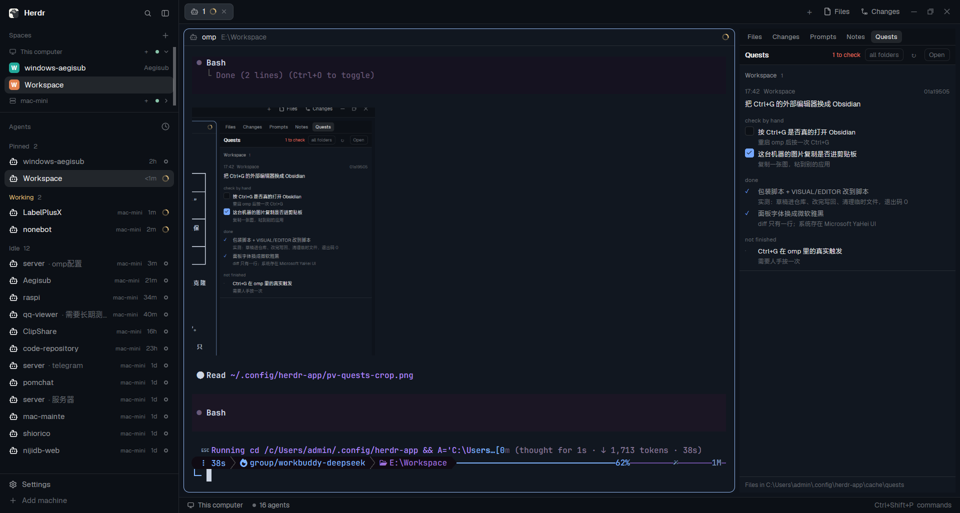

# herdr-app-mod-tabs-panel



Herdr's shipped `tabs` mod remembers whether the side panel is open **per space**: switch to another
space (which switching agents usually does) and the panel closes, or flips back to Files. This is a
copy of that mod with one change: the panel keeps whatever state you left it in. Only the Files and
Changes buttons change it.

## Install

Ask your agent in Herdr:

```text
Read ~/.config/herdr-app/AGENTS.md, then add the mod at https://github.com/AlanWanco/herdr-app-mod-tabs-panel
```

By hand:

1. `mods/tabs-panel/` → `~/.config/herdr-app/mods/tabs-panel/`, then
   `herdr-app check ~/.config/herdr-app/mods/tabs-panel`.
2. Point a cloned layout's tab bar at it: in `~/.config/herdr-app/layouts/<your-layout>.json`, the
   block whose `content` is `{"mod": "tabs"}` becomes `{"mod": "tabs-panel"}`.
   A cloned layout, not Herdr's own: shipped layouts are replaced on every start.

## What is different

`tabs/main.js` is Herdr's, unchanged in `~/.config/herdr-app/mods/tabs/`. The copy drops only
`syncPanel`, the function that stores each space's panel choice in the mod's own `localStorage` and
replays it when the space changes. Everything else — the tab pills, the `+` menu, the Files and
Changes buttons, the window buttons, the scroll-wheel tab switching — is the same code.

## Watch out

- This is a **clone**, so Herdr's updates to `tabs` do not reach it. Re-clone and re-apply the one
  edit when the original gains something you want (the diff is a single function).
- `div()` vs `v_flex()`: not used here, but the original draws its rows with `h_flex()`; keep it.
- The mod references assets under `mods/tabs/` (`win-min.svg`, `win-max.svg`, `win-close.svg`) and
  `mods/workspace-chrome/spinner.svg`; those still resolve from the app root, so do not delete the
  shipped `tabs` folder.

MIT licensed. `tabs` itself is Herdr's, shipped with the app.
